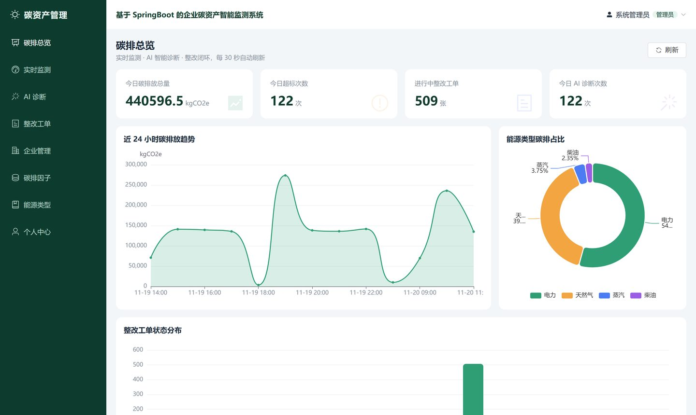
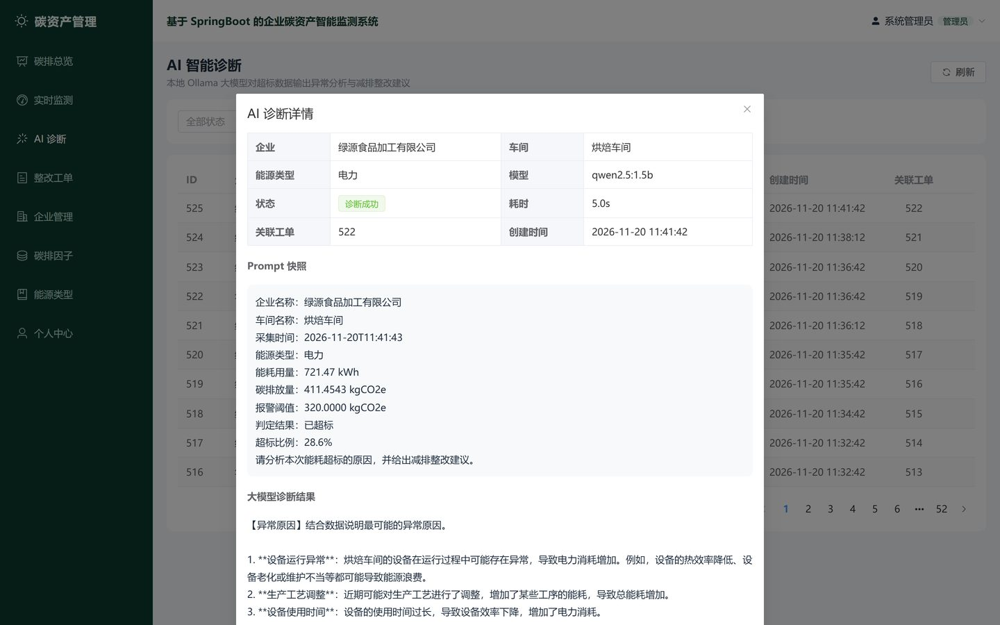
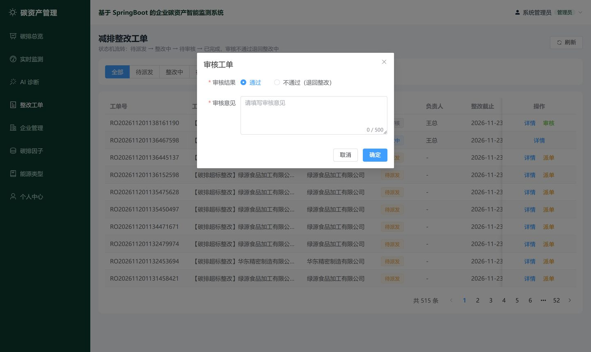
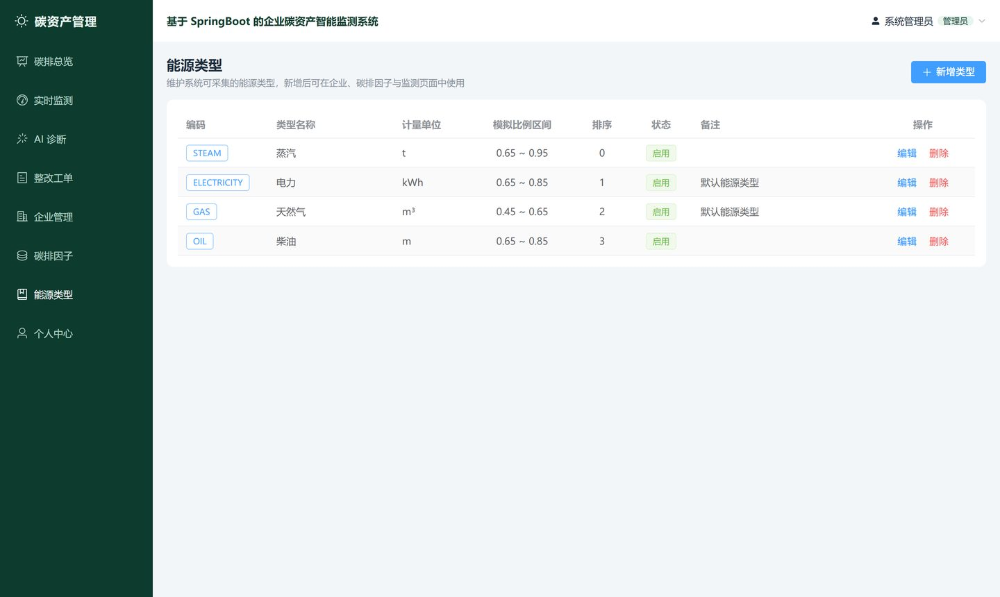

# 企业碳资产智能监测系统

> 基于 Spring Boot 3 与 Vue 3 的碳排放监测、AI 诊断与整改工单闭环平台

`Java 21`　`Spring Boot 3.5`　`MyBatis`　`MySQL 8`　`Spring AI`　`Ollama`　`Vue 3`　`TypeScript`　`Element Plus`　`ECharts`

## 项目简介

面向用能企业的碳资产管理平台：系统按周期采集各企业的能耗数据，依据碳排因子核算碳排放量，
超过企业阈值时自动标记并触发本地模型诊断，随后自动生成整改工单，形成
**监测 → 核算 → 超标判定 → 智能诊断 → 整改审核** 的完整闭环。

平台分为管理员与整改负责人两类角色，权限在服务层校验，整改负责人只能看到派发给自己的工单。

## 功能一览

| 模块 | 说明 |
| --- | --- |
| 认证与权限 | JWT 登录，ADMIN / OPERATOR 双角色，越权返回 403，工单按负责人数据隔离 |
| 企业管理 | 企业 / 车间档案、排放阈值、可采集能源类型配置 |
| 能源类型字典 | 维护编码、名称、计量单位与模拟比例区间，支持新增、编辑、停用 |
| 碳排因子 | 按能源类型维护因子值，自动校验单位与字典一致 |
| 能耗采集 | Spring Task 每 30 秒自动采集，也支持页面手动触发 |
| 碳排看板 | 今日排放总量、超标次数、24 小时趋势、能源结构占比、工单状态 |
| AI 智能诊断 | 异步调用本地模型生成诊断结论与整改建议，模型不可用时自动走规则模板 |
| 整改工单 | 待派发 → 整改中 → 待审核 → 已完成，审核不通过退回整改中 |
| 个人中心 | 查看与修改个人资料、修改密码 |

## 技术栈

| 层次 | 技术 |
| --- | --- |
| 后端 | Java 21、Spring Boot 3.5、Spring AI、MyBatis、Spring Security Crypto |
| 前端 | Vue 3、TypeScript、Element Plus、ECharts、Pinia、Vue Router、Vite |
| 数据库 | MySQL 8（InnoDB / utf8mb4） |
| 本地模型 | Ollama + qwen2.5:1.5b |
| 认证 | JWT（有效期 12 小时） |

## 系统架构

- **前端展示层**：Vue 3 + Element Plus + ECharts，负责表单、列表与图表。
- **接入与安全层**：Vite 代理 `/api`，JWT 拦截器统一鉴权，统一 `Result` 响应与全局异常处理。
- **业务服务层**：9 个 Controller 只做参数校验与响应包装，业务逻辑集中在 Service。
- **数据访问层**：MyBatis 接口 + XML，SQL 全部下沉到 Mapper，事务边界留在 Service。
- **基础设施层**：MySQL 存储业务数据，Ollama 提供本地推理，Spring Task 驱动定时采集。

依赖方向单向向下，任意一层的改动不会扩散到其他层。

## 快速开始

### 环境要求

- JDK 21、Maven 3.8+
- Node.js 18+
- MySQL 8.0
- Ollama（可选，用于本地 AI 诊断）

### 1. 准备数据库

无需手动建库建表：连接串带有 `createDatabaseIfNotExist=true`，首次启动会自动创建
`carbon_manage` 数据库并执行建表脚本，同时初始化演示账号与基础数据。

如本机数据库账号密码不是 `root / 123456`，请先修改
`src/main/resources/application.yml` 中的 `spring.datasource.username` 与 `password`。

### 2. 启动后端

```bash
mvn spring-boot:run
```

或打包后运行：

```bash
mvn -DskipTests package
java -jar target/carbon-manage-1.0.0.jar
```

后端默认地址：<http://localhost:8080>

### 3. 启动前端

```bash
cd frontend
npm install
npm run dev
```

浏览器访问 <http://localhost:5173>，Vite 已将 `/api` 代理到 8080。

### 4. 演示账号

| 账号 | 密码 | 角色 |
| --- | --- | --- |
| admin | 123456 | 管理员 |
| operator1 | 123456 | 整改负责人（王工） |
| operator2 | 123456 | 整改负责人（李工） |

## AI 诊断（可选）

```bash
ollama pull qwen2.5:1.5b
ollama serve
```

- 模型未安装、未启动或调用超时：系统自动使用规则模板生成整改建议，业务不中断。
- 关闭 AI 触发：`application.yml` 中设置 `carbon.ai.enabled: false`。
- 关闭定时采集：`carbon.collect.enabled: false`（仍可在页面手动采集）。

## 目录结构

```
Carbon-Manage/
├─ src/main/java/com/carbon/manage/
│  ├─ controller/        9 个 REST 控制器
│  ├─ service/           业务服务与 AI 诊断、指令组装
│  ├─ mapper/            MyBatis 接口
│  ├─ entity/            8 个实体
│  ├─ enums/             角色、工单状态等枚举
│  ├─ task/              定时采集任务
│  ├─ config/            安全、异步线程池、数据初始化
│  └─ common/            统一响应、异常与用户上下文
├─ src/main/resources/
│  ├─ db/schema.sql      8 张表的建表脚本（启动时自动执行）
│  ├─ mapper/            9 个 MyBatis XML
│  └─ application.yml    数据源、JWT、AI 等配置
├─ frontend/src/
│  ├─ views/             9 个页面
│  ├─ api/               接口封装
│  ├─ store/             Pinia 状态
│  └─ router/            路由与角色守卫
└─ screenshots/          README 截图
```

## 数据库设计

共 8 张核心表：

| 表 | 用途 |
| --- | --- |
| `t_user` | 登录账号、角色与状态 |
| `t_energy_type` | 能源类型字典（编码、单位、模拟比例区间） |
| `t_enterprise` | 企业与车间档案、超标阈值 |
| `t_enterprise_energy_type` | 企业配置的采集类型 |
| `t_emission_factor` | 各能源类型的碳排因子 |
| `t_energy_data` | 能耗用量、碳排量与超标标记 |
| `t_ai_diag_log` | 诊断日志、模型名与耗时 |
| `t_rectification_order` | 整改工单与流转状态 |

业务表中的能源类型按编码冗余保存，字典调整不影响历史数据；被历史数据引用的类型只可停用、不可删除。

## 接口概览

9 个 Controller、39 个 REST 接口，统一前缀 `/api`：

| 模块 | 路径 |
| --- | --- |
| 认证 | `/api/auth` |
| 用户与个人中心 | `/api/users` |
| 企业 | `/api/enterprises` |
| 能源类型字典 | `/api/energy-types` |
| 碳排因子 | `/api/factors` |
| 能耗数据 | `/api/energy` |
| 碳排看板 | `/api/dashboard` |
| AI 诊断 | `/api/diagnosis` |
| 整改工单 | `/api/orders` |

## 运行截图

| 碳排看板 | AI 智能诊断 |
| --- | --- |
|  |  |

| 整改工单审核 | 能源类型字典 |
| --- | --- |
|  |  |

## 设计要点

- **采集核算**：碳排量 = 能耗用量 × 因子值，`BigDecimal` HALF_UP 保留 4 位小数，并保存采集时刻的阈值快照。
- **诊断防重**：依赖能耗数据的唯一索引，同一条数据只诊断一次、只生成一张工单。
- **异步隔离**：诊断提交到独立线程池，采集主流程不阻塞；事务提交后再触发，避免读到未提交数据。
- **状态机 + CAS**：工单状态转移集中定义，更新时校验原状态，避免并发重复审核。
- **模型兜底**：本地模型不可用时自动切换规则模板，保证演示与业务连续。
